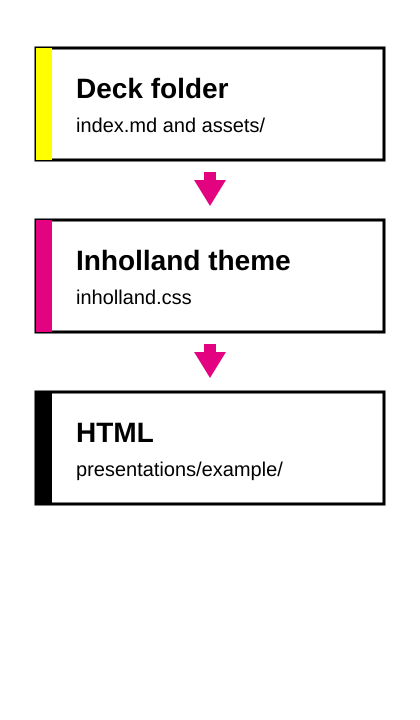

<!-- only include once in document -->

<!-- _class: title -->

# How a lesson deck is built

A sample presentation in the Inholland theme

---

<!-- _class: lead -->

## From notes to slides

- Write the lesson in one folder
- Mark what each slide is for
- Build HTML when the wording is settled

---

## One folder, one deck

- `index.md` holds the slides
- Images live in `assets/`
- Paths stay relative, such as `./assets/workflow.svg`

The generator reads this folder and writes `index.html` beside a copy of `assets/`.

---

## Mark the role of the slide

| Class | When to use it |
| --- | --- |
| `title` | The opening slide |
| `lead` | A new section |
| `quote` | A quotation |
| `columns` | Two groups side by side |
| `closing` | A thank-you or contact slide |

`_class` applies to that slide only. `class` would stick to every slide after it.

---

<!-- _class: columns -->

## In the markdown

The lesson text stays in this file. Applying the theme does not rewrite it.

## After the build

HTML is the handout. A PDF is written only when you ask for one.

---

<!-- _class: quote -->

> Set the theme and the slide classes. Leave the wording, the order, and the images as they are.

inholland-themer

---

## Where each piece lives

- The lesson stays in the deck folder
- The theme CSS stays with the themer
- The HTML is written under `presentations/`

---

## What the build does

### Read the deck

One Marp file, plus `assets/`.

### Apply the theme

`theme: inholland` loads the house style.

### Write the HTML

The deck folder name becomes the output folder.

---

<!-- _class: closing -->

# Thank you

Questions are welcome.

[inholland.nl](https://www.inholland.nl)
